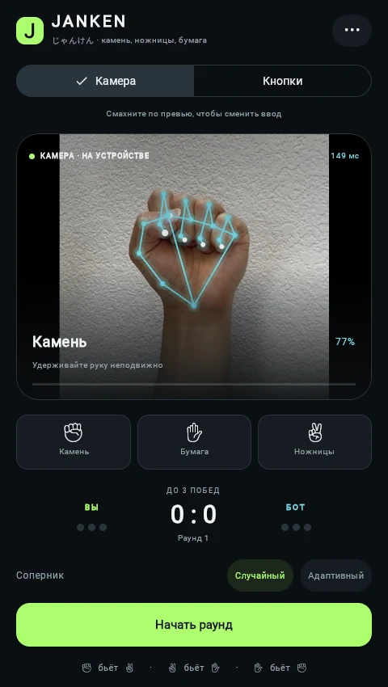
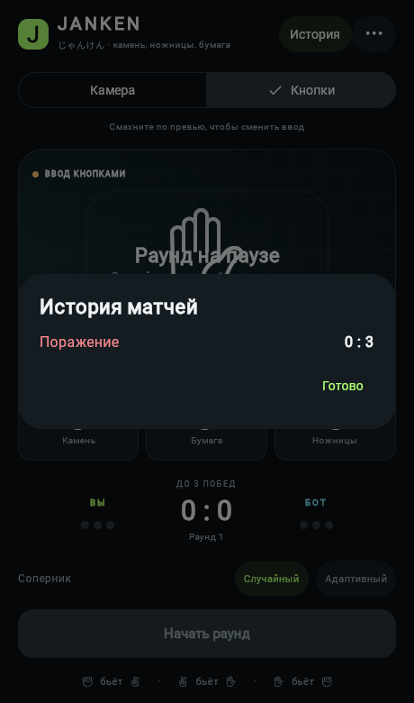

# Janken

Камень, ножницы, бумага с управлением жестами через камеру. Janken рисует скелет кисти поверх видео и позволяет перейти на кнопки прямо посреди раунда.

[Скачать APK для Android 8.0+](https://github.com/serpanti/janken/releases/download/v0.7.0-android-r2/janken-0.7.0-android-r2.apk)

- **Kotlin Multiplatform, Compose Multiplatform и Material 3.** Общее игровое ядро и интерфейс для Android, iOS, desktop и браузера. Камера подключается через платформенные адаптеры.
- **Clean Architecture и MVI.** Игровое ядро определяет правила и контракты. Store на Coroutines и StateFlow обрабатывает кадры, таймер и ввод по очереди. Это позволяет тестировать раунды без камеры.
- **CameraX и MediaPipe.** На Android CameraX передаёт кадры, по которым MediaPipe находит 21 точку кисти. Игра сначала применяет 2D-правила, а при неоднозначной форме использует классификатор. Для Android обучен свой классификатор с замороженным экстрактором MediaPipe. Связка дала **1 509 правильных ответов из 1 532** на отложенных кадрах с игровыми жестами.
- **Room 3, Koin и Kermit.** Room сохраняет матчи локально, Koin внедряет платформенные зависимости, Kermit ведёт журнал диагностики. В браузере SQLite хранит базу в OPFS.

## Демонстрация



Раунд записан в браузере на тестовом видеопотоке. Бот выбирает ход до отсчёта. В адаптивном режиме он учитывает предыдущие раунды матча.

После перезапуска счёт и сыгранные раунды текущего матча восстанавливаются. В разделе «История» можно посмотреть и очистить результаты завершённых матчей.



## Платформы

| Платформа | Камера | Что проверено |
| --- | --- | --- |
| Android 8.0+ | CameraX и MediaPipe Tasks Vision | Четыре теста распознавания и восстановление раунда после остановки приложения на эмуляторе. |
| Web | Kotlin/Wasm, `getUserMedia` и MediaPipe в Web Worker | Камера и сохранение истории проверены в Chromium. |
| Desktop | Kotlin/JVM, OpenCV и MediaPipe в локальном Python-процессе | На Windows проверены адаптер камеры и повторное открытие базы. Для macOS и Linux предусмотрена сборка на целевой ОС. |
| iOS и iPadOS 15.4+ | AVFoundation и MediaPipe Tasks Vision через Swift | Kotlin-код скомпилирован для устройства и симулятора. Для запуска нужен Mac с Xcode. |

## Быстрый старт

Для сборки нужны JDK 21 и Android SDK 36. Запускайте команды из корня проекта. На Windows используйте `.\gradlew.bat` вместо `./gradlew`.

```sh
# Android APK
./gradlew :app:assembleDebug

# Веб-версия для локального запуска
./gradlew :webApp:wasmJsBrowserDevelopmentRun
```

APK появится в `app/build/outputs/apk/debug/app-debug.apk`. Веб-камера работает на localhost или по HTTPS.

[Запуск desktop и iOS, сборки и тесты](docs/PLATFORMS.md)

[Архитектура и навигация по коду](docs/ARCHITECTURE.md) · [Модель и сравнение на отложенных кадрах](docs/MODEL_AND_TRAINING.md) · [Лицензии и источники](NOTICE.md)
