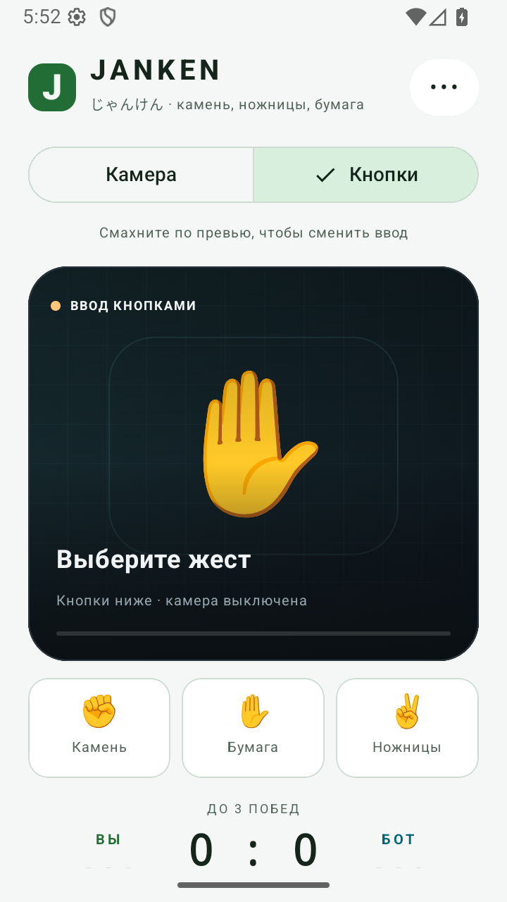
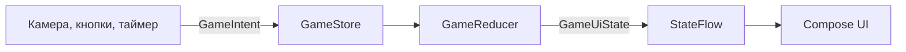

# Janken

Камень, ножницы, бумага против бота с распознаванием жестов в реальном времени. Игра рисует скелет кисти поверх превью камеры, показывает распознанный ход и прогресс удержания. Между камерой и кнопками можно переключиться прямо во время раунда с сохранением счёта.

**Kotlin Multiplatform · Compose Multiplatform · Material 3 · Clean Architecture · MVI · CameraX · MediaPipe**



Android 0.7.0 проверен на OnePlus 8T. [Тег Android 0.7.0](https://github.com/serpanti/janken/tree/v0.7.0-android) · [Демонстрация раунда с камерой в браузере](https://github.com/serpanti/janken/blob/develop/docs/demo-camera.webp)

## Архитектура

Принципы **Clean Architecture** задают границы между игровыми правилами, интерфейсом и интеграциями. Таймер раунда, счёт, стратегия бота и проверка удержания живут в общем Kotlin-коде. Доступ к камере и сохранение настроек реализует Android-адаптер.

| Модуль | Ответственность |
| --- | --- |
| [`domain`](domain) | Правила матча, выбор хода бота и проверка стабильности жеста. |
| [`presentation`](presentation) | Контракт MVI, переходы состояния и обработка событий. |
| [`shared`](shared) | Игровой экран на Compose Multiplatform с Material 3, превью и скелетом кисти. |
| [`camera`](camera) | Выбор хода по 2D-точкам кисти и классу модели. |
| [`app`](app) | CameraX, MediaPipe Tasks Vision, Android ViewModel и сохранение настроек. ViewModel явно передаёт часы и область корутин в Store. |

**MVI** управляет игровым состоянием. Таймер, камера и кнопки отправляют события в один Store. Он обрабатывает их последовательно, а чистый Reducer вычисляет следующее состояние и эффекты. Compose получает состояние через `StateFlow`. Такой поток позволяет менять способ ввода в одном матче и тестировать переходы без камеры и системных часов. Вибрация после раунда доставляется отдельным эффектом через `SharedFlow`.



## Распознавание жестов

CameraX выводит превью и отдаёт в анализ последний доступный кадр. MediaPipe извлекает 21 точку кисти. Сначала игра проверяет форму по 2D-геометрии пальцев. Если правила не дали однозначного хода, игра использует ответ классификатора. Чтобы засчитать ход, жест должен продержаться не менее 350 мс и подтвердиться минимум на трёх кадрах. Кадры обрабатываются на устройстве.

Для Android обучен собственный классификатор на четыре класса — `rock`, `paper`, `scissors` и `None`. Поиск кисти, ключевые точки и извлечение признаков используют предобученные веса MediaPipe. Во время обучения эти веса были заморожены, обучалась классифицирующая часть. На 1 532 отложенных кадрах с игровыми жестами связка 2D-правил и модели распознала 1 509 кадров правильно и пропустила 23. [Методика и известный случай ложного срабатывания](docs/MODEL_AND_TRAINING.md)

## Как запустить

Откройте проект в Android Studio и запустите конфигурацию `app` на устройстве с Android 8.0 или новее. Для сборки нужны JDK 21 и Android SDK 36. На Windows используйте `gradlew.bat` вместо `./gradlew`.

```sh
./gradlew :app:assembleDebug
```

APK появится в `app/build/outputs/apk/debug/app-debug.apk`. Веб, desktop и iOS развиваются в ветке `develop`. [Инструкции для остальных платформ](https://github.com/serpanti/janken/blob/develop/docs/PLATFORMS.md)

## Проверки

```sh
./gradlew :domain:jvmTest :presentation:jvmTest :camera:jvmTest :app:lintDebug
./gradlew :app:connectedDebugAndroidTest
```

JVM-тесты покрывают правила, MVI и 2D-классификацию. Инструментальные тесты запускают MediaPipe с моделью из APK на тестовых изображениях.

Текст Apache License 2.0 находится в [LICENSE](LICENSE). Происхождение моделей, тестовых изображений, шрифтов и лицензии сторонних компонентов перечислены в [NOTICE.md](NOTICE.md).
