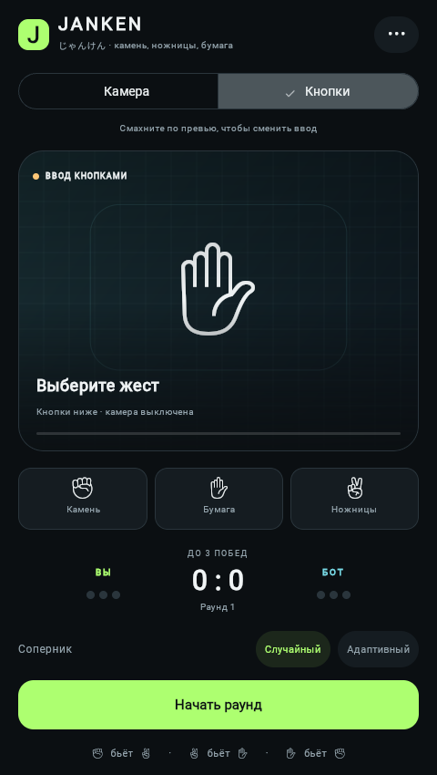

# Janken

Камень, ножницы, бумага с управлением жестами через камеру. Janken распознаёт кисть на устройстве, рисует её скелет поверх видео и показывает, какой ход считывает игра. Можно перейти на кнопки прямо посреди матча.

<table>
  <tr>
    <th>Ход через камеру</th>
    <th>Игра кнопками</th>
  </tr>
  <tr>
    <td></td>
    <td></td>
  </tr>
</table>

Демонстрация записана в браузерной версии с тестовым видеопотоком.

## Как попробовать

Откройте проект в Android Studio, выберите конфигурацию `app` и запустите её на устройстве с Android 8.0 или новее. APK можно собрать из корня проекта:

```sh
./gradlew :app:assembleDebug
```

Сборка появится в `app/build/outputs/apk/debug/app-debug.apk`. Для запуска в браузере:

```sh
./gradlew :webApp:wasmJsBrowserDevelopmentRun
```

Для сборки нужны JDK 21 и Android SDK 36. На Windows используйте `.\gradlew.bat` вместо `./gradlew`. [Запуск desktop и iOS, проверки платформ](docs/PLATFORMS.md).

## Как устроен проект

- **Общее ядро на Kotlin Multiplatform.** `domain` хранит правила матча и стратегию бота. `presentation` управляет игровым состоянием через MVI, `shared` рисует интерфейс на Compose Multiplatform и Material 3.
- **Камера и локальный ML.** Android получает кадры через CameraX. MediaPipe находит 21 точку кисти, `camera` проверяет её форму по 2D-координатам и при необходимости использует ответ модели. На Android классификатор обучен на четырёх классах, включая посторонние жесты.
- **Игровой цикл.** Бот выбирает ход до отсчёта. Чтобы случайное движение не стало ходом, игра принимает жест после короткого удержания. Один MVI Store сохраняет состояние матча при переключении между камерой и кнопками.
- **Локальная история.** Room 3 сохраняет завершённые матчи и сыгранные раунды текущего матча. История открывается из верхней панели. На мобильных устройствах и desktop база лежит в каталоге приложения, в браузере — в OPFS.
- **Зависимости и диагностика.** Koin собирает общий Store с платформенными часами и хранилищами. Kermit пишет ошибки камеры и локального хранилища в журнал устройства или консоль браузера.

Кадры обрабатываются локально. Android 0.7.0 проверен на OnePlus 8T. Веб-сценарий с камерой проверяется в Chrome на тестовом потоке.

[Архитектура и навигация по коду](docs/ARCHITECTURE.md) · [Модель и сравнение на отложенных кадрах](docs/MODEL_AND_TRAINING.md) · [Лицензии и источники](NOTICE.md)
