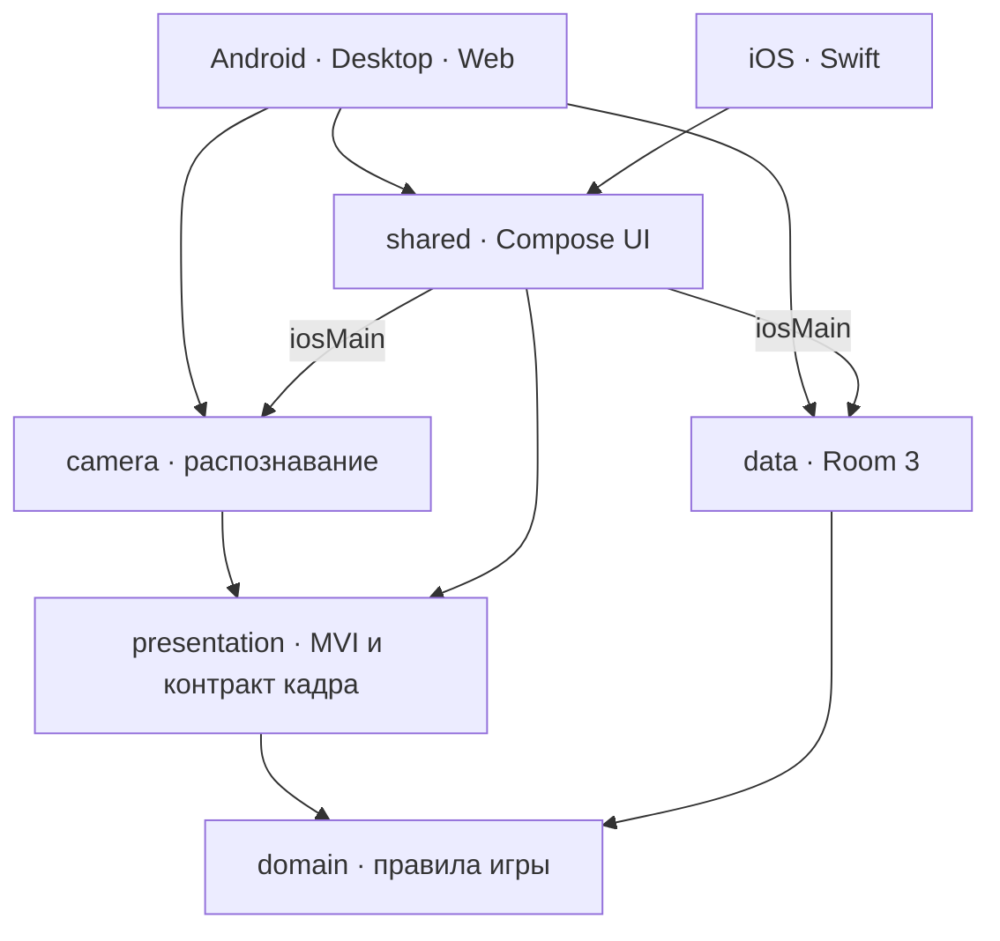

# Архитектура Janken

Зависимости направлены от приложений и адаптеров к общему игровому коду.

| Модуль | С чего начать |
| --- | --- |
| `domain` | [GameRules](../domain/src/commonMain/kotlin/dev/janken/prototype/game/GameRules.kt) ведёт раунд от отсчёта до результата. [BotStrategy](../domain/src/commonMain/kotlin/dev/janken/prototype/game/BotStrategy.kt) выбирает ход по завершённым раундам. [MatchHistoryRepository](../domain/src/commonMain/kotlin/dev/janken/prototype/game/MatchHistoryRepository.kt) задаёт контракт хранения истории. |
| `data` | [MatchDatabase](../data/src/commonMain/kotlin/dev/janken/data/MatchDatabase.kt) описывает схему Room 3 и запросы. Android, iOS и desktop используют Bundled SQLite, веб использует SQLite в Web Worker с хранением в OPFS. |
| `presentation` | [GameStore](../presentation/src/commonMain/kotlin/dev/janken/prototype/mvi/GameStore.kt) обрабатывает события по очереди. [GameReducer](../presentation/src/commonMain/kotlin/dev/janken/prototype/mvi/GameReducer.kt) вычисляет новое состояние и эффекты. |
| `shared` | [JankenScreen](../shared/src/commonMain/kotlin/dev/janken/prototype/ui/JankenScreen.kt) отображает игру и историю матчей. [GameModule](../shared/src/commonMain/kotlin/dev/janken/prototype/di/GameModule.kt) связывает Store с платформенными зависимостями через Koin. |
| `camera` | [HandShapeRecognition](../camera/src/commonMain/kotlin/dev/janken/camera/HandShapeRecognition.kt) выбирает ход по точкам кисти и метке модели. [CameraWire](../camera/src/commonMain/kotlin/dev/janken/camera/CameraWire.kt) читает сообщения адаптеров. |
| `app` | [CameraFeed](../app/src/main/java/dev/janken/prototype/camera/CameraFeed.kt) связывает CameraX и MediaPipe. [GameViewModel](../app/src/main/java/dev/janken/prototype/GameViewModel.kt) привязывает Store к жизненному циклу Android и может перенести раунды из старого `SavedStateHandle`. |
| `webApp` | [Camera Host](../webApp/src/wasmJsMain/resources/camera-host.js) получает поток браузера. [Web Worker](../webApp/src/wasmJsMain/resources/camera-worker.js) запускает модель. |
| `desktopApp`, `desktop-camera` | [DesktopCamera](../desktopApp/src/main/kotlin/dev/janken/desktop/DesktopCamera.kt) запускает локальный [Python worker](../desktop-camera/camera_worker.py) и читает результаты и JPEG-превью. |
| `iosApp` | [CameraViewController](../iosApp/iosApp/CameraViewController.swift) управляет AVFoundation и MediaPipe. [Мост Kotlin/Swift](../shared/src/iosMain/kotlin/dev/janken/prototype/MainViewController.kt) передаёт результаты в общее приложение. |

## От кадра до результата

1. Камера отдаёт кадр в MediaPipe. Превью и распознавание обновляются независимо. На Android CameraX хранит последний кадр анализа, а адаптер отправляет в модель по одному кадру за раз.
2. Результат приходит в Store как `FrameReceived` с точками кисти, кандидатом на ход и временем кадра. Кнопки используют тот же фильтр через тики таймера.
3. Reducer проверяет, что кадр свежий и попал в окно хода. Для хода нужны минимум три наблюдения одного жеста за 350 мс или дольше.
4. При принятии хода Reducer добавляет раунд и возвращает эффект `RoundCompleted`. Store сохраняет раунд, затем публикует результат и эффект. На Android эффект используется для вибрации.

Часы и случайный выбор хода бота остаются в Store. Reducer получает готовые значения, поэтому переходы можно проверить тестами без камеры и реального таймера. Активный раунд содержит заранее выбранный ход бота, а UI получает результат после завершения раунда.

При запуске Store читает историю из Room до обработки первого игрового события. Игра восстанавливает счёт и сыгранные раунды. Регистрация жеста и таймер нового хода начинаются заново.

## Стек

Kotlin 2.3.21, Compose Multiplatform 1.9.3, Material 3, Coroutines и StateFlow. Room 3.0.3 хранит историю, Koin 4.2.2 внедряет зависимости, Kermit 2.2.0 пишет локальные логи. Android использует AGP 8.13.2, CameraX 1.5.1 и MediaPipe Tasks Vision 1.2.2. Браузерная сборка использует Kotlin/Wasm и MediaPipe Tasks Vision 1.2.2. Desktop использует Kotlin/JVM, Python и OpenCV, iOS — Kotlin/Native, Swift и MediaPipeTasksVision.
